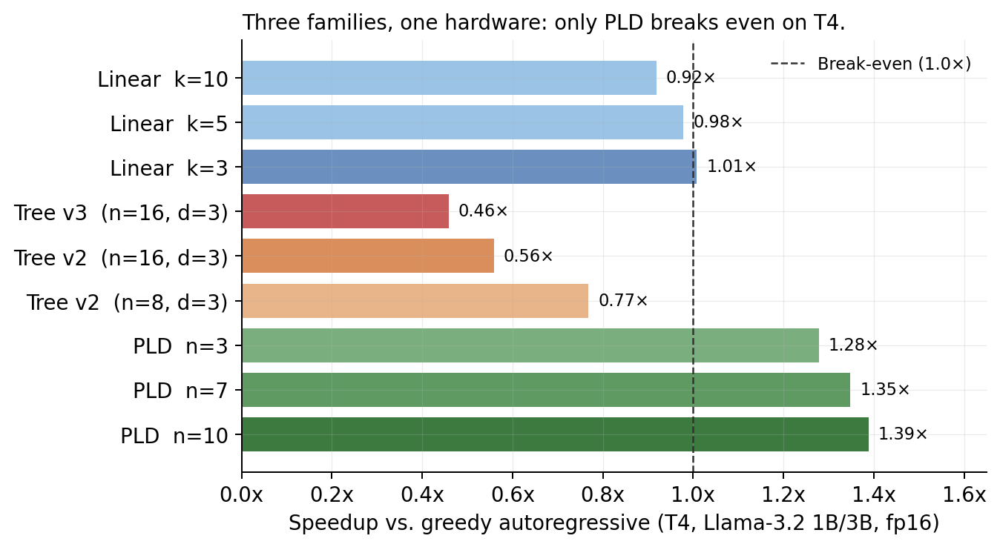
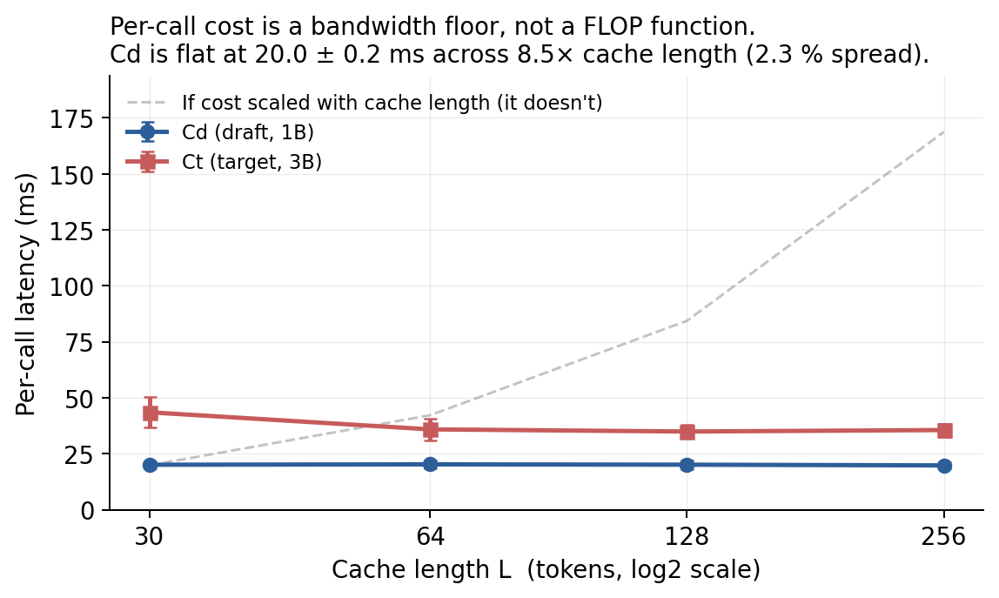
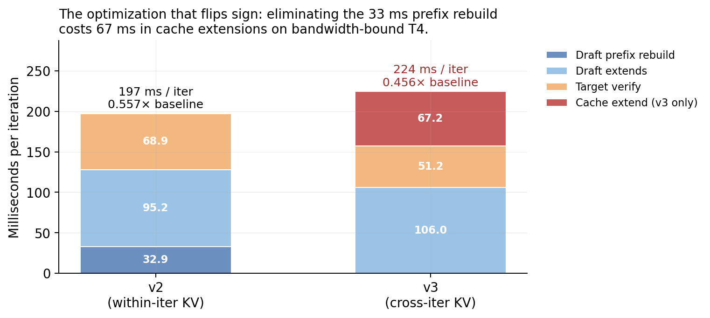

# Speculative Decoding on a T4

Does speculative decoding speed up a small model on a small GPU? I measured it on an NVIDIA T4 at batch size 1, with Llama-3.2-1B drafting for Llama-3.2-3B in fp16. Mostly, it does not. Linear speculative decoding broke even at best (1.01× at k = 3) and slowed down as drafts got longer. A 16-node tree ran at 0.56×, and Sequoia's own cost model, given the measured acceptance, never forecast a win on this GPU. Prompt lookup decoding, which needs no draft model, was the only method that sped decoding up: 1.28–1.39× on mean throughput.

The cause is per-call cost. A single-token forward of the 1B draft took 20 ms whether its KV cache held 30 tokens or 256, against about 35 ms for the 3B target. Per call, the draft costs about 60% of the target, not the 33% its parameter count suggests. Only about 8 ms of those 20 ms is reading the weights. The rest is fixed per-call overhead in eager PyTorch, paid by every speculative step that calls a model.

Every number below comes from a saved measurement in [`src/results/`](./src/results/) or a notebook output in [`src/notebooks/`](./src/notebooks/). The main ones print in seconds without a GPU. The paper is being extended into a preprint.



## Results

| Method | Setting | Speedup, mean | Speedup, median | Throughput (tok/s, mean ± SD) |
|---|---|---:|---:|---:|
| Greedy decoding | | 1.00× | 1.00× | 26.42 ± 1.48 |
| Linear SD (draft model) | k = 3 | 1.01× | 0.90× | 26.68 ± 4.99 |
| | k = 5 | 0.98× | 0.89× | 25.83 ± 4.61 |
| | k = 7 | 0.97× | 0.89× | 25.54 ± 4.36 |
| | k = 10 | 0.92× | 0.84× | 24.34 ± 4.68 |
| Tree SD, v2 (prompt re-encoded each step) | n = 8, d = 3 | 0.77× | 0.74× | 20.38 ± 2.70 |
| | n = 16, d = 3 | 0.56× | 0.56× | 14.71 ± 2.13 |
| Tree SD, v3 (KV caches kept across steps) | n = 8, d = 3 | 0.56× | 0.58× | 14.90 ± 2.82 |
| | n = 16, d = 3 | 0.46× | 0.44× | 12.05 ± 0.71 |
| Prompt lookup decoding | 3 tokens | 1.28× | 1.12× | 33.69 ± 8.78 |
| | 5 tokens | 1.32× | 1.12× | 34.77 ± 12.15 |
| | 7 tokens | 1.35× | 1.15× | 35.66 ± 12.74 |
| | 10 tokens | 1.39× | 1.15× | 36.68 ± 15.55 |

Each row is 30 timed runs (10 prompts, 3 runs each) of 128 new tokens with greedy decoding. Speedup is mean or median throughput over greedy decoding's. The spread is mostly prompt to prompt. At k = 5, linear SD ranged from 0.82× to 1.35× by prompt, best on a code prompt. Prompt lookup with 5 tokens ranged from 1.00× to 2.61×. Means are pulled up by a few prompts with high overlap, so the medians are lower.

Two more results, also with the 1B draft:

- **Sampling:** at k = 5, linear SD fell to 0.77× at temperature 0.6 and 0.83× at 0.8.
- **A 4-bit target:** against Llama-3.1-8B in 4 bits, linear SD slowed decoding at every k from 3 to 10 (0.93–0.95×). I did not measure acceptance for that pair.

## Per-call cost



| KV cache length | Draft, 1B (ms) | Target, 3B (ms) |
|---:|---:|---:|
| 30 | 20.06 ± 1.52 | 43.49 ± 6.69 * |
| 64 | 20.22 ± 1.90 | 35.86 ± 4.79 |
| 128 | 20.08 ± 1.83 | 34.90 ± 2.90 |
| 256 | 19.77 ± 1.41 | 35.55 ± 2.89 |

The table times single-token forwards with a persistent KV cache: 50 timed calls per length after 5 warm-ups (mean ± SD). \* The first target row includes warm-up effects and is left out of averages.

Across an 8.5× range in cache length, the draft's mean cost moved by 0.45 ms. The cost ratio c = Cd/Ct is 0.57 from this probe and 0.596 from standalone generation (22.42 / 37.63 ms per token). I use 0.596 throughout. A second standalone run gave 0.66. All three are far above the parameter ratio: 0.33 nominal, 0.38 counting the real 1.24B and 3.21B parameters.

Weights explain only part of the cost. Streaming the draft's 2.5 GB of fp16 weights at the T4's 320 GB/s takes about 8 ms, and the target's 6.4 GB about 20 ms. The remaining 12–15 ms per call is fixed overhead: kernel launches and small element-wise ops in eager PyTorch. It is about the same for both models, which pulls c toward 1. CUDA graphs or a fused runtime would cut it; I have not measured by how much.

## Tree decoding

I ported Sequoia's tree dynamic program and gave it the measured probability that each sibling is the accepted one (305 samples) and c = 0.596. For a tree of at most 16 nodes and 3 levels it predicts 2.94 tokens per iteration. The tree accepted 2.95, so Sequoia's acceptance model holds on this hardware. Its cost model then predicts 1.00× with the verify cost the notebooks assumed (t(16) = 1.15 single target calls), and 0.93× with the 1.36 I measured. On a T4, Sequoia's own model says a tree does not pay.

The notebooks' first run of the dynamic program printed 1.68×. It was fed the conditional rates P(rank k | rank > k − 1), which sum past 1 across siblings, so it credited a 3-level tree with 4.94 tokens per iteration, more than three levels can yield. [`cost_model.sequoia_dp`](./src/specdec/cost_model.py) is the corrected port, and `python -m src.bench.bench_tree --show-dp` prints its prediction next to the saved run.

The runtimes landed below the model's 0.93–1.00×. Per iteration (n = 16, d = 3):

| | Model | v2, measured | v3, measured |
|---|---:|---:|---:|
| Tokens per iteration | 2.94 | 2.95 | 2.94 |
| Draft (ms) | 67.3 | 128.1 (prefix 32.9 + 4 × 23.8) | 106.0 (4 × 26.5) |
| Verify (ms) | 43.3 | 68.9 | 51.2 |
| Cache update (ms) | 0 | 0 | 67.2 |
| Iteration (ms) | 110.6 | 197.0 | 224.5 |
| Speedup | 1.00× | 0.56× | 0.46× |

The measured parts account for the end-to-end time. For v2, 2.95 tokens per 197.0 ms gives 0.563×, within 1.1% of the measured 0.557×. For v3 the same accounting gives 0.49× against 0.456×. The whole gap to the model is cost, in two places:

- **Verify:** with the prompt re-encoded each step, verify cost 1.83× a single-token target call (Ct). With a cached prefix it cost 1.36× Ct, against the assumed 1.15×.
- **Drafting:** every draft call paid the 20 ms floor, and the runtime makes more draft calls per iteration than the model counts.



Keeping both KV caches across steps (v3) made decoding slower, 0.46× against 0.56×. The reason is how the caches are updated: after each step, v3 appends the accepted tokens with one forward in each model. Each of those forwards pays the per-call floor. Together they cost 67.2 ms, more than the 32.9 ms prefix rebuild they replaced.

Read the tree numbers as what a direct Hugging Face implementation gets on a T4, not as a ceiling for tree decoding there. My runtime differs from production tree decoders in three ways:

- v2 re-encodes the prompt every iteration.
- Both versions expand each interior node with its own draft call, instead of one call per tree level.
- v3 runs fresh forwards to update the caches, instead of keeping the KV entries the verify pass already computed.

Both runtimes reproduced greedy decoding token for token on a 20-token check of one prompt.

## A rule of thumb

[`src/specdec/advisor.py`](./src/specdec/advisor.py) turns the per-call model into a quick check. It estimates c = (Tw,d + Tf) / (Tw,t + Tf), where Tw is weight bytes over memory bandwidth and Tf is a per-call overhead you measure with the probe. From c it recommends prompt lookup, linear SD at k = 3, a tree, or no speculation.

```
$ python -m src.bench.advise --hw T4 --draft 1B --target 3B
Predicted c:       0.596
Recommendation:    pld
```

The T4 default Tf = 13 ms comes from the probe above, so the T4 estimate is a fit, not an independent test. Outside the T4 it is unvalidated. Use it to tell which regime you are in, not to predict a speedup.

## Reproduce

Without a GPU (Python 3.10+):

```bash
pip install -r requirements.txt                                  # pytest, matplotlib; no torch
python -m src.bench.probe_percall                                # per-call cost table
python -m src.bench.bench_tree --tree-config 16x3 --version v2 --show-dp   # tree prediction and per-iteration ms
python -m src.bench.bench_tree --tree-config 16x3 --version v3
python -m src.bench.advise --hw T4 --draft 1B --target 3B
python -m pytest tests/ -q
```

These print the saved measurements. The linear SD, prompt lookup, sampling and 4-bit results are in the outputs of `spec_decoding_phase1.ipynb`, `spec_decoding_phase1b.ipynb` and `spec_decoding_phase1c.ipynb`.

On a T4:

1. Open the notebooks in Colab with a T4 runtime.
2. Install `requirements-cuda.txt`.
3. Add a Hugging Face token with access to Llama 3.2.
4. Run the notebooks in this order. The full run takes about 90 minutes.

| Notebook | Measures |
|---|---|
| `spec_decoding_phase1.ipynb` | Greedy baseline, linear SD, prompt lookup, sampling |
| `spec_decoding_phase1b.ipynb` | Linear SD against a 4-bit 8B target |
| `spec_decoding_phase1c.ipynb` | Standalone Cd and Ct; acceptance by k |
| `phase2a_swor_acceptance.ipynb` | Acceptance by sibling rank (`swor_acceptance_vector.json`) |
| `phase2b_with_cd_probe.ipynb` | Tree DP, tree runtime v2, per-call probe (`phase2b_tree_results.json`, `cd_probe_results.json`) |
| `phase2b_v3_persistent_cache.ipynb` | Tree runtime v3 (`phase2b_v3_results.json`) |
| `phase3_profiling_refined.ipynb` | PyTorch profiler breakdown (`profiler_results.json`) |

## Setup

- **Hardware:** one NVIDIA T4 (16 GB, 320 GB/s) on Google Colab, with CUDA 12.8, PyTorch 2.10 and Transformers 4.45.
- **Models:** Llama-3.2-1B (draft) and Llama-3.2-3B (target) in fp16, plus Llama-3.1-8B in 4 bits for one comparison.
- **Workload:** 10 prompts across general knowledge, code, summarization, instruction and long context. 128 new tokens, batch size 1, greedy unless noted.
- **Protocol:** 3 warm-ups, then 30 timed runs per configuration, with `torch.cuda.synchronize()` around every timed region. Seed 42.
- **Methods:** Hugging Face assisted generation (linear SD), Hugging Face prompt lookup (`prompt_lookup_num_tokens`), and my own tree runtime built on Sequoia's dynamic program.

## Limitations

- One GPU, one model pair plus one 4-bit comparison, batch size 1.
- Eager PyTorch without CUDA graphs. The per-call overhead behind most results is partly a property of eager execution.
- The tree runtime is unoptimized, as described above, so its numbers are not the best a T4 can do.
- The tree prediction uses an assumed verify-cost curve. With the measured verify cost it falls from 1.00× to 0.93×. The acceptance probabilities at ranks 4 and 5 rest on 9 and 6 samples.
- Ten prompts. The tree runtimes' correctness was checked on one.
- Nothing here was measured on compute-rich GPUs such as the A100 or H100.

## Citation

```bibtex
@misc{fu2026specdecodingt4,
  title  = {Speculative Decoding on a T4: Per-Call Cost, Not Parameter Count, Decides the Speedup},
  author = {Fu, Zanwen},
  year   = {2026},
  note   = {Preprint in preparation},
  url    = {https://github.com/zanwenfu/speculative-decoding-t4}
}
```

## License

MIT. See [`LICENSE`](./LICENSE).
